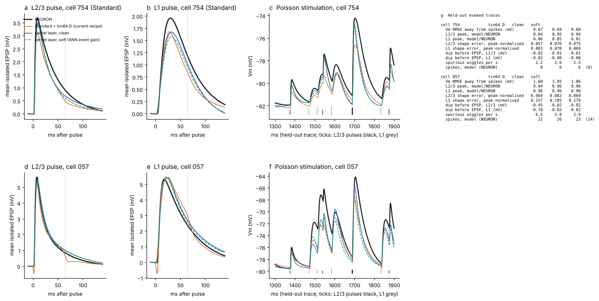
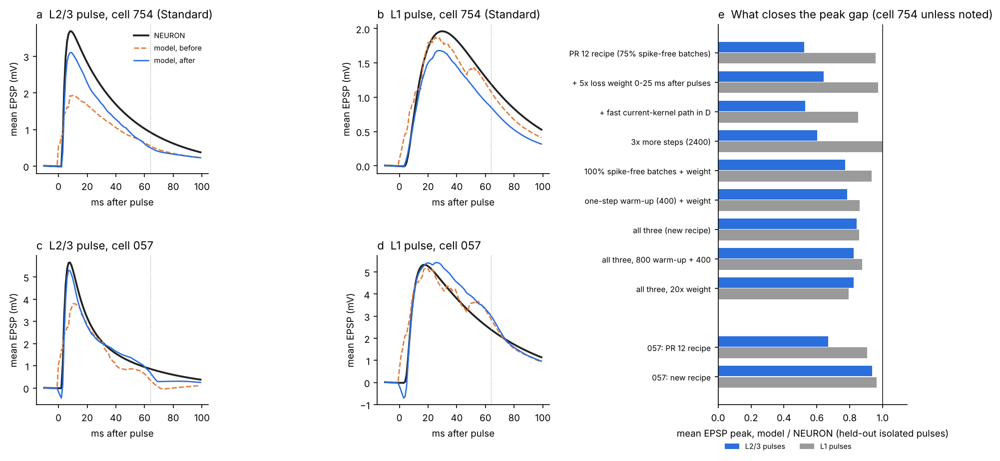
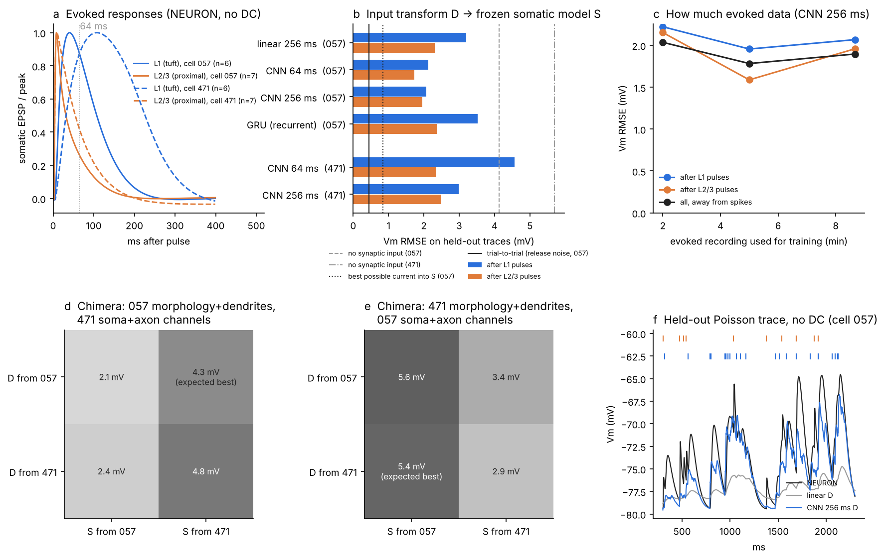

# Evoked synaptic input: can the Standard model's front end learn it? (feasibility test)

## Update 2026-11-26: hardcoded synaptic kernel layer (smooth EPSPs by construction)

Viktor's question: the tcn64 D EPSPs (previous update) look jagged, with extra bumps, while NEURON's are smooth.
Can EPSP dynamics be hardcoded in a layer that, like an AlphaSynapse or a GLIF, computes the current from the
membrane potential and the time since each event?

**Yes, and it removes the artefacts.** Where the jaggedness came from (panels a, d, e): D's current passes through the
CNN-LSTM's 64 ms window. That gives a dip before the EPSP (−0.45 mV L2/3, −0.70 mV L1 on 057), a kink or drop
when the event leaves the 64 ms window (dotted line), and extra wiggles in trains (6.5 spurious extrema/s on 057 vs 3.0).

**The layer** (`code/synaptic_kernel.py`):

    somatic DC --64 ms window--> CNN-LSTM front end --> x(t) --+--> Izhikevich (Vm, spikes) + branches
                                                               |            | Vm(t-1)
    stim pulses --> depression R --> rise/decay states --> g(t) --> I_syn = g (E_rev - Vm)

- Per pathway: two recursive states per kernel component, updated every 1 ms like the branch gates:
  xr ← xr·e^(−1/τr) + a, xd ← xd·e^(−1/τd) + a, g = w·norm·(xd − xr) (difference of exponentials; τr→τd is an alpha synapse).
  a = pulse intensity × R, with Tsodyks–Markram depression R (U, τ_rec). The state carries how long ago each event arrived,
  so the layer needs no window.
- I_syn = g·(E_rev − Vm), using the Izhikevich Vm of the previous step, so the driving force comes for free. An optional
  NMDA-like slow term with a Mg block B(V) exists (`--nmda`), but it was not run (AMPA-only data).
- Learnable per pathway: w, τr, τd, E_rev, U, τ_rec (12 numbers for 1 component, 20 for 2 components). The kernel goes
  straight into the Izhikevich input. The CNN-LSTM front end sees only the somatic current, so somatic-injection behaviour
  is untouched. Check: with no events the layer adds exactly zero current (`code/check_somatic.py`: 24 Standard
  square/ramp/noise traces, max |ΔVm| 0.0 mV, 0 spike mismatches).
- **clean**: nothing else. **soft**: a small 64 ms CNN over the stimulus sets each event's conductance gain (exp, zero-init).
  The ANN can scale events (summation, intensity nonlinearity) but cannot change the kernel shape.
- Same training recipe as the tcn64 D (spike-free batches, 5× weight 0–25 ms after pulses, 150 one-step warm-up steps,
  then free running), 400 steps, ~23 min on 1 thread (`code/fit_kernel.py`).

**One kernel component was not enough** (round 1, `kernel_clean`, `kernel_soft`). The EPSPs were smooth, but they
decayed too slowly and peaked 20–35 % low (754 L2/3 0.75, L1 0.67; Vm RMSE 0.82 vs 0.67 mV). The bare Izhikevich
membrane decays more slowly than the cell. For injected current, the front end corrects this; a synaptic current that
bypasses it does not get that correction. **Fix:** a second, slow component that is subtracted (`--ncomp 2 --signed`,
τd 16–72 ms). This is a smooth membrane correction, not a synaptic property. It is the smooth version of the undershoot
the free-current oracle found earlier.

Held-out traces (20 per cell; isolated events: n = 27 L1, 23 L2/3):

| | 754 tcn64 D | 754 clean | 754 soft | 057 tcn64 D | 057 clean | 057 soft |
|---|---|---|---|---|---|---|
| Vm RMSE away from spikes (mV) | 0.67 | 0.69 | 0.68 | **1.68** | 1.95 | 1.86 |
| L2/3 peak, model/NEURON | 0.84 | **0.95** | 0.94 | 0.94 | 0.96 | 0.96 |
| L1 peak, model/NEURON | 0.86 | 0.85 | 0.81 | 0.96 | 0.96 | 0.96 |
| L2/3 shape error, peak-normalised | 0.057 | 0.076 | 0.075 | 0.064 | 0.082 | 0.069 |
| L1 shape error, peak-normalised | 0.083 | 0.070 | 0.069 | 0.157 | 0.185 | 0.179 |
| dip before EPSP, L2/3 / L1 (mV) | −0.02 / −0.02 | −0.01 / 0.00 | −0.01 / 0.00 | −0.45 / −0.70 | −0.02 / −0.02 | −0.02 / −0.02 |
| EPSPs with >1 peak (L1) | 0 % | 0 % | 0 % | 22 % | 0 % | 0 % |
| spurious wiggles per s (NEURON: 0) | 2.2 | 2.6 | 2.5 | 6.5 | 3.0 | 2.9 |
| spikes, model (NEURON) | 8 (9) | 6 (9) | 6 (9) | 21 (14) | 26 (14) | 23 (14) |

(The NEURON traces have release noise. That noise, not jaggedness, explains most of the remaining "spurious wiggles":
they are extrema ≥0.05 mV with no NEURON extremum within 3 ms. Metrics: `code/shape_metrics.py` → `shape.json`.)

What this shows:
- **Smoothness is fixed by construction**: no dip before the EPSP, no kink at 64 ms, no multi-peak EPSPs, and wiggles halve on 057.
  The tcn64 D on 754 was already fairly clean; on 057 it was the jagged one.
- **Peaks**: the L2/3 peak, which was the long-standing problem on 754, goes from 0.84 to 0.95, at the right time (9–10 ms vs 8).
- **Overall accuracy**: on 754 (the Standard's own cell), the kernel layer is equal to D (0.68–0.69 vs 0.67 mV). On 057
  (all-active dendrites) it is 0.2–0.3 mV worse, and only on Poisson trains (2.4 vs 1.9 mV; isolated pulses 1.35 vs 1.26).
  This is supralinear summation in 057's active tuft, which a linear kernel with depression cannot produce. The soft
  variant's event gain recovers about a third of it (1.95 → 1.86). The kernel's L1 EPSP on 057 also decays somewhat too
  slowly. 057 over-fires a little more (23–26 vs 21 spikes, NEURON 14).
- Fitted kinetics are physiological-looking: L2/3 somatic-equivalent τr 1.6–1.8, τd 2.2 ms; L1 τr 4.5–6.8, τd 6.7–14 ms;
  E_rev −2.6 to +1.4 mV; U 0.36–0.55, τ_rec 170–370 ms (the simulation used U 0.4, τ_rec 300 ms).

**Recommendation.** Use the kernel layer (soft variant) as the synaptic input stage on top of S. It gives smooth EPSPs,
correct L2/3 peaks, explicit driving force, a few interpretable numbers per pathway (gain, τ, E_rev, depression) that
are the per-cell input features the network decomposition needs, and no change to somatic behaviour. If real recordings
show strong supralinear summation (057-like), let the soft gain CNN see more history, or add the NMDA term. The tcn64 D
stays as the more flexible reference.

Run: `EVOKED_SET=ampa python fit_kernel.py --cell <cell> --variant soft --ncomp 2 --signed [--init <round-1 folder>]`,
then `python shape_metrics.py <results dirs>`, `python plot_kernel.py`, `python check_somatic.py <dir>`.
Round 2 was started from round-1 values for the first component (`--init`; the folder needs a `kernel.json`).
Results: `results_ampa/<cell>/kernel_{clean,soft}[_k2s]/` (kernel.json, metrics.json, shape.json, test_predictions.npz
with the synaptic current), `results_ampa/kernel_layer.{png,json}`.

## Update 2026-11-24 (2): L2/3 EPSP peak fixed by training changes (64 ms window, AMPA only)

The AMPA-only rerun below under-predicted the fast L2/3 EPSP peak. Per held-out isolated pulse (no other pulse
from -100 to +150 ms, no spike; `code/peak_metrics.py`) the model/NEURON peak ratio was 0.52 on 754 and 0.67 on 057.

**S is not the limit.** A free current optimised through the frozen S on 48 isolated L2/3 events
(`code/oracle_events.py`) reaches a peak ratio of 1.01 (peak at 8 vs 9 ms, 0.04 mV RMSE). The current it needs is a
sharp ~100 pA pulse 2–3 ms after the stimulus with a negative undershoot, which D was not learning: D's
current was too small and too broad, so the model EPSP peaked late (10–11 ms vs 8 ms) and low.

**What worked** (all on cell 754, tcn64, 800 steps; figure panel e):

| Change | L2/3 peak ratio | L1 peak ratio | Vm RMSE away from spikes (mV) |
|---|---|---|---|
| PR 12 recipe (75 % spike-free batches) | 0.52 | 0.96 | 0.69 |
| + 5x loss weight 0–25 ms after each pulse (`--event-weight 5`) | 0.64 | 0.97 | 0.69 |
| + learnable fast current kernel in D (`--model tcn64k`) | 0.53 | 0.85 | 0.69 |
| 3x more steps (2400) | 0.60 | 1.00 | 0.67 |
| 100 % spike-free batches + weight (`--sub-frac 1`) | 0.77 | 0.93 | 0.70 |
| one-step (teacher-forced) warm-up, 400 steps + weight (`--one-step-iters 400`) | 0.78 | 0.86 | 0.69 |
| **all three: spike-free batches + weight + one-step warm-up (new recipe)** | **0.84** | 0.86 | 0.67 |
| same, 800 warm-up + 400 free steps | 0.82 | 0.87 | 0.70 |
| same, 20x weight | 0.82 | 0.79 | 0.70 |
| **057, PR 12 recipe → new recipe** | **0.67 → 0.94** | 0.91 → 0.96 | 1.66 → 1.68 |

Model peak time with the new recipe: 9 ms on 754 (NEURON 8), 7 ms on 057 (NEURON 8). Spike counts unchanged
(|Δn| 0.05 and 0.35 per trace).

Why these help:
- **One-step warm-up.** During the first steps S's Vm is reset to the recording every ms, so the error at t depends
  directly on D's current at t. In free-running training the error comes through the membrane, which low-passes
  the gradient. Brief current features then learn very slowly (3x more free steps only reached 0.60). After the
  warm-up, the usual free-running loss finishes the fit.
- **Spike-free batches only.** Mixed-in spiking segments keep pulling the fast peak down (a large fast EPSP near
  threshold risks a mistimed spike in S). Spiking is S's job, so D can be trained on spike-free segments only
  (held-out spike counts are unaffected).
- **Event weighting.** Fast peaks are a small share of the time points; weighting the 25 ms after each pulse helps a
  bit (0.52 → 0.64) and more in combination.
- A dedicated fast current kernel (`tcn64k`) did not help: the kernel barely moved, the same slow-learning problem.

Recipe: `python fit_input_transform.py --cell <cell> --model tcn64 --iters 800 --one-step-iters 400 --lr 1e-3 --sub-frac 1.0 --event-weight 5`
(~30 min on 2 threads).

Remaining issues: 754 is still 16 % low on L2/3 and its EPSP decays a little too fast (20–60 ms); L1 on 754 drops
from 0.96 to 0.86. On 057 D adds a small negative dip right after the pulse (−0.4 mV L2/3, −0.7 mV L1, panel c, d)
before the EPSP. This is part of the undershoot-shaped current D learns for the fast peak; it does not appear in
NEURON. Both cells have only 23 (L2/3) and 27 (L1) isolated held-out events, so ratios are ±~0.05.

Files: `code/peak_metrics.py` (per-event peaks -> `peaks.json` in each results folder), `code/oracle_events.py`
(free-current ceiling on isolated events -> `results_ampa/487661754/oracle_events_p1/`), `code/plot_peakfix.py`
(figure + `results_ampa/peak_fix.json`). New options in `code/fit_input_transform.py`: `--event-weight`,
`--event-win`, `--one-step-iters`, `--one-step-gain`, `--deriv-weight` (not tested), `--width`, `--out-scale`, `--init`,
`--model tcn64k`.

## Update 2026-11-24: AMPA-only rerun (supersedes the window conclusion below)

Viktor pointed out that the first-round events were far too slow: his recorded L1 and L4-L2/3 evoked events
(Olah & Rowan, eLife) peak much faster. The slowness came from strong NMDA (ratio 1.0, 50 ms decay) plus the
all-active fits' large apical cm (3–6.6 µF/cm²). The Billeh V1 model has no NMDA either, so the rerun uses
AMPA only (`evoked_sim.py --nmda-ratio 0`), everything else as before.

- Cells: the Standard's own perisomatic cell 487661754 ("754", g ≤ 0.5 nS per synapse, L2/3 calibrated to a
  10 mV full-intensity EPSP; L1 saturates near 4.5 mV), and all-active 521409057 ("057"). 471 was dropped
  (with AMPA only its calibration needed ~1.5 µS per tuft synapse).
- Held-out mean EPSPs (NEURON): 754 L2/3 peaks at 9 ms, L1 at 30 ms; 057 L2/3 at 8 ms, L1 at 16 ms.
- Training fix: with fast, small events the loss was dominated by spike-timing error in spiking segments and
  D learned almost nothing (L2/3 EPSP 0.5 vs 4.2 mV). Drawing 75 % of each batch from spike-free segments
  (`--sub-frac 0.75`, lr 1e-3) fixes most of it. S itself reproduces fast EPSC-shaped currents
  (100 pA, τ 2 ms: 4.5 mV peak at 9 ms vs NEURON 4.8 mV at 6 ms), so the limit is D's training, not S.

| Cell | D | away from spikes | after L1 | after L2/3 |
|---|---|---|---|---|
| 754 | none (DC only) | 1.68 | 1.45 | 1.70 |
| 754 | linear 256 ms (old sampling) | 1.38 | 1.32 | 1.64 |
| 754 | CNN 64 ms | 0.69 | 0.52 | 0.85 |
| 754 | CNN 256 ms | 0.64 | 0.46 | 0.73 |
| 057 | none (DC only) | 3.43 | 3.87 | 2.14 |
| 057 | CNN 64 ms | 1.66 | 2.01 | 1.52 |
| 057 | CNN 256 ms | 1.70 | 2.31 | 1.56 |

Release-noise ceiling: 0.21 mV (754), 0.29 mV (057). Spike counts: |Δn| 0.05 per trace (754).

**Conclusion:** with AMPA-only kinetics a 64 ms window does as well as 256 ms (within 0.05 mV on both cells).
So the Standard's 64 ms convention can be kept for D; recommendation 2 below changes accordingly. Remaining
gap: the fast L2/3 EPSP peak is still underestimated by 35–50 % (2.2–2.8 vs 4.2 mV on 754; 4.3 vs 6.4 mV on 057)
while L1 is matched; that is a training issue (more steps or an event-weighted loss), not the window.
If real recordings show an NMDA component in trains (Viktor's eLife data show pathway-specific NMDA/HCN
amplification), a 64 ms D will need an extra slow state or a longer window for those pathways only.

---

## First round (2026-11-23, AMPA + strong NMDA; events too slow, kept for the record)

Question (Viktor, 2026-11-23): if we record ~10 L2/3 PCs with a stimulating electrode in L1 and one in L2/3
(as in Olah & Rowan, eLife), can the model learn each cell's input processing, separately from its somatic
transform, so the in vivo firing-rate tail can be split into a somatic and an input-processing share?

Everything here is in silico, on two Allen all-active L2/3 PC models (Nandi et al. fits, stub axon):
521409057 ("057") and 513531471 ("471").

## Setup

**Simulated experiment** (`code/evoked_sim.py`, NEURON, dt 0.025 ms, Vm stored at 1 ms):
- L1 electrode: 40 synapses on the apical tuft (apical segments beyond 60 % of the maximal apical path distance).
  L2/3 electrode: 40 synapses on basal dendrites and proximal apical obliques (20–120 µm).
- Each synapse is AMPA (0.2/2 ms) + NMDA (2/50 ms, Jahr–Stevens Mg block, `code/NMDA_JS.mod`), equal peak conductances.
- A pulse of intensity n recruits the first n×40 synapses (fixed order), each releases with p = 0.8 × R
  (Tsodyks–Markram depression, U 0.4, τ_rec 300 ms), 2 ms latency. No inhibition (GABA-A-blocked configuration).
- Stimulus strength per pathway calibrated so a full-intensity pulse gives a ~15 mV EPSP at rest.
- 150 traces × 4 s per cell (10 min): Poisson pulse trains (1–15 Hz per pathway), 5-pulse trains at 10–100 Hz
  (one pathway or both with −20..+20 ms offsets), and single/paired pulses. 70 % of traces carry a somatic DC
  current of 0.4–1.1 × rheobase, so about half of them spike.
- Controls on 20 traces per cell: NMDA blocked, and a repeat with new release draws (trial-to-trial ceiling).
- Chimeras (60 traces each): 057 morphology and dendritic parameters with 471's somatic and axonal channels, and
  the reverse. Same synapse sites and stimulus strengths as the morphology donor; new stimulus patterns.

**Model** (`code/fit_input_transform.py`):

    stim (L1, L2/3 pulse intensities, 1 ms) --D--> somatic-equivalent current --+--> S (frozen) --> Vm
                                                     somatic DC current -------+

S is each cell's Standard fit from somatic current injection (`experiments/data_budget/results/<cell>/full`).
Only D is trained, end to end through the frozen S, on the recorded Vm (clipped at −40 mV for training).
400–800 Adam steps, batch 32 × 500 ms segments (150 ms recorded-Vm seed). Test: 20 held-out traces, run
free from 250 ms (before any stimulus) to 4 s. Scores: Vm RMSE away from spikes, and in the 150 ms after
pulses of one pathway only.

D variants: linear FIR filter (256 ms), dilated causal CNN with a 64 ms or 256 ms receptive field, GRU
(unbounded memory), and the Standard's own CNN-LSTM on 64 ms windows.

## Results

**Response time course (NEURON, panel a).** Proximal (L2/3) EPSPs peak at 8–11 ms and 26–36 % of their area
lies beyond 64 ms. Tuft (L1) EPSPs peak at 41 ms (057) and 108 ms (471) and decay to 10 % at 190 / 310 ms; 49 % and
87 % of their area lies beyond 64 ms. (471's slowness partly reflects its fitted apical cm.) Blocking NMDA
changes Vm by 2.4 mV RMS on the control traces of 057.

**Input transform (panel b, Vm RMSE on held-out traces, mV).**

| Cell | D | away from spikes | after L1 pulses | after L2/3 pulses |
|---|---|---|---|---|
| 057 | none (DC only) | 4.13 | 5.03 | 2.97 |
| 057 | linear 256 ms | 3.10 | 3.20 | 2.31 |
| 057 | CNN 64 ms | 1.87 | 2.12 | 1.73 |
| 057 | CNN 256 ms | 1.90 | 2.07 | 1.96 |
| 057 | GRU | 3.63 | 3.52 | 2.37 |
| 471 | none (DC only) | 5.69 | 6.14 | 4.26 |
| 471 | CNN 64 ms | 3.84 | 4.56 | 2.33 |
| 471 | CNN 256 ms | 2.75 | 2.98 | 2.49 |

Reference levels for 057: trial-to-trial release noise 0.45 mV; the best current that can be optimised
freely into S (`code/oracle_current.py`, 6 traces) 0.84 mV. So S itself can follow these traces, and most of
the remaining error is D's.
- A linear PSC-style filter misses the summation and NMDA build-up in trains (panel f). A nonlinear D is needed.
- 64 ms is enough when the tuft response is fast (057) and clearly not enough when it is slow (471, L1 error
  4.6 → 3.0 mV with 256 ms). Use ≥ 256 ms.
- Spike counts follow well (count r 0.94–0.99), but spike timing stays poor (Γ ≤ 0.08). That is S's known
  limit (same Γ on somatic steps for these cells), not D's.
- The GRU trained slowly and stayed undertrained in 800 steps. The Standard CNN-LSTM on 64 ms windows was
  unstable and slow here (it needs grappler off, `--no-grappler`) and was stopped at step 325; no result.

**Data needed (panel c, 057, CNN 256 ms).** 2 min: 2.04 mV; 5 min: 1.78 mV; 8.7 min: 1.90 mV. A few
minutes of evoked recording per cell are enough in silico. Real recordings vary more (recruitment drift,
polysynaptic input), so plan for ~10 min.

**Swap test (panels d, e).** On each chimera, the S from the *morphology donor* wins by 2–2.5 mV
(2.1 vs 4.3 mV; 2.9 vs 5.4 mV). Which D is used matters much less (0.3–0.5 mV). So the expected "D from the
dendrite donor + S from the soma donor" pairing is the worst or second worst in both. S, fitted from somatic
injection, describes the whole cell seen from the soma, dendritic load included. It does not describe the
somatic channels alone. The D/S split is therefore an operational split: "response to somatic current" vs
"what the synaptic pathway adds". It is not a split into somatic vs dendritic channels.

## Recommendation
1. Keep each cell's S (somatic injection, ~5 min) and add a separate per-cell D, trained through the frozen S
   on evoked Vm. Input = the stimulus trains of both electrodes (time × intensity), output = somatic-equivalent current.
2. ~~For D use a ≥ 256 ms receptive field.~~ Superseded by the AMPA-only rerun: a 64 ms causal CNN is enough for
   realistic AMPA kinetics. Sample spike-free segments for most of each batch when training.
3. Evoked protocol per cell (~10 min): intensity series on each pathway, 5-pulse trains at 10–100 Hz, paired
   L1 + L2/3 pulses at −20..+20 ms offsets, and irregular (Poisson) stimulation on top of a few somatic DC levels.
   Optional: APV and gabazine conditions to label the NMDA and feed-forward inhibition parts.
4. Don't promise "swap D between cells" as a physical counterfactual. For the tail decomposition, summarise
   each D by features: pathway gain per stimulus unit, L1/L2/3 ratio, summation/NMDA index, decay time. Feed those
   to the network as per-cell input heterogeneity (e.g. scaling each cell's synaptic weights by pathway) and
   compare with intrinsic heterogeneity from S at matched mean rate.
5. Mapping to the Allen network: its synapses are current-based PSCs with no dendritic location, and it has no
   long-range top-down input. So D's L1 pathway needs an explicit rule for which sources count as tuft input.

## Files
- `code/evoked_sim.py`: NEURON simulation (`--chimera-soma` for chimeras); `code/NMDA_JS.mod`: NMDA synapse
  (compile together with `simulations/additional_cells/models/modfiles`).
- `code/fit_input_transform.py`: D fits; `code/oracle_current.py`: free-current ceiling; `code/eval_swap.py`: chimera test;
  `code/response_kinetics.py`: EPSP time course; `code/plot_results.py`, `code/summarize.py`.
- `data/<cell>/evoked.npz` + `meta.json` (stim, DC, Vm, NMDA-block and repeat controls); `results/`: fits, metrics, figure.

Runtime: ~12 min NEURON per cell (4 cores); each D fit ~30–35 min on 2 threads.
