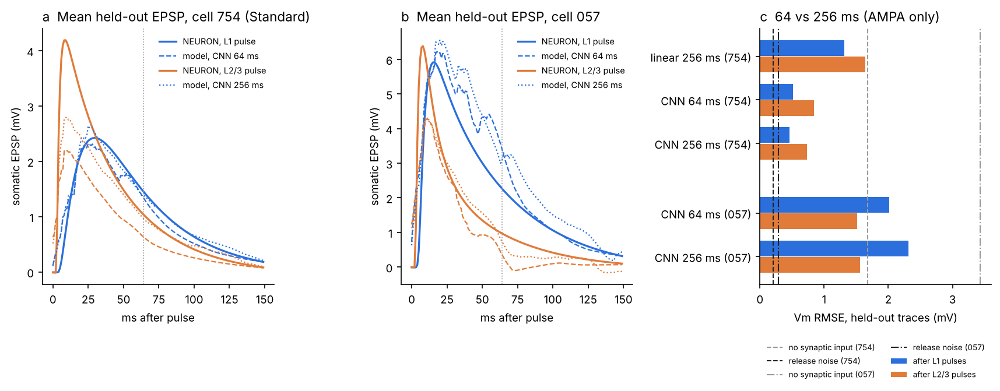

# Evoked synaptic input: can the Standard model's front end learn it? (feasibility test)

## Update 2026-11-24: AMPA-only rerun (supersedes the window conclusion below)

Viktor pointed out that the first-round events were far too slow: his recorded L1 and L4-L2/3 evoked events
(Olah & Rowan, eLife) peak much faster. The slowness came from strong NMDA (ratio 1.0, 50 ms decay) plus the
all-active fits' large apical cm (3–6.6 µF/cm²). The Billeh V1 model has no NMDA either, so the rerun uses
AMPA only (`evoked_sim.py --nmda-ratio 0`), everything else as before.

- Cells: the Standard's own perisomatic cell 487661754 ("754", g ≤ 0.5 nS per synapse, L2/3 calibrated to a
  10 mV full-intensity EPSP; L1 saturates near 4.5 mV), and all-active 521409057 ("057"). 471 was dropped
  (with AMPA only its calibration needed ~1.5 µS per tuft synapse).
- Held-out mean EPSPs (NEURON): 754 L2/3 peaks at 9 ms, L1 at 30 ms; 057 L2/3 at 8 ms, L1 at 16 ms.
- Training fix: with fast, small events the loss was dominated by spike-timing error in spiking segments and
  D learned almost nothing (L2/3 EPSP 0.5 vs 4.2 mV). Drawing 75 % of each batch from spike-free segments
  (`--sub-frac 0.75`, lr 1e-3) fixes most of it. S itself reproduces fast EPSC-shaped currents
  (100 pA, τ 2 ms: 4.5 mV peak at 9 ms vs NEURON 4.8 mV at 6 ms), so the limit is D's training, not S.

| Cell | D | away from spikes | after L1 | after L2/3 |
|---|---|---|---|---|
| 754 | none (DC only) | 1.68 | 1.45 | 1.70 |
| 754 | linear 256 ms (old sampling) | 1.38 | 1.32 | 1.64 |
| 754 | CNN 64 ms | 0.69 | 0.52 | 0.85 |
| 754 | CNN 256 ms | 0.64 | 0.46 | 0.73 |
| 057 | none (DC only) | 3.43 | 3.87 | 2.14 |
| 057 | CNN 64 ms | 1.66 | 2.01 | 1.52 |
| 057 | CNN 256 ms | 1.70 | 2.31 | 1.56 |

Release-noise ceiling: 0.21 mV (754), 0.29 mV (057). Spike counts: |Δn| 0.05 per trace (754).

**Conclusion:** with AMPA-only kinetics a 64 ms window does as well as 256 ms (within 0.05 mV on both cells).
So the Standard's 64 ms convention can be kept for D; recommendation 2 below changes accordingly. Remaining
gap: the fast L2/3 EPSP peak is still underestimated by 35–50 % (2.2–2.8 vs 4.2 mV on 754; 4.3 vs 6.4 mV on 057)
while L1 is matched; that is a training issue (more steps or an event-weighted loss), not the window.
If real recordings show an NMDA component in trains (Viktor's eLife data show pathway-specific NMDA/HCN
amplification), a 64 ms D will need an extra slow state or a longer window for those pathways only.

---

## First round (2026-11-23, AMPA + strong NMDA; events too slow, kept for the record)

Question (Viktor, 2026-11-23): if we record ~10 L2/3 PCs with a stimulating electrode in L1 and one in L2/3
(as in Olah & Rowan, eLife), can the model learn each cell's input processing, separately from its somatic
transform, so the in vivo firing-rate tail can be split into a somatic and an input-processing share?

Everything here is in silico, on two Allen all-active L2/3 PC models (Nandi et al. fits, stub axon):
521409057 ("057") and 513531471 ("471").

## Setup

**Simulated experiment** (`code/evoked_sim.py`, NEURON, dt 0.025 ms, Vm stored at 1 ms):
- L1 electrode: 40 synapses on the apical tuft (apical segments beyond 60 % of the maximal apical path distance).
  L2/3 electrode: 40 synapses on basal dendrites and proximal apical obliques (20–120 µm).
- Each synapse is AMPA (0.2/2 ms) + NMDA (2/50 ms, Jahr–Stevens Mg block, `code/NMDA_JS.mod`), equal peak conductances.
- A pulse of intensity n recruits the first n×40 synapses (fixed order), each releases with p = 0.8 × R
  (Tsodyks–Markram depression, U 0.4, τ_rec 300 ms), 2 ms latency. No inhibition (GABA-A-blocked configuration).
- Stimulus strength per pathway calibrated so a full-intensity pulse gives a ~15 mV EPSP at rest.
- 150 traces × 4 s per cell (10 min): Poisson pulse trains (1–15 Hz per pathway), 5-pulse trains at 10–100 Hz
  (one pathway or both with −20..+20 ms offsets), and single/paired pulses. 70 % of traces carry a somatic DC
  current of 0.4–1.1 × rheobase, so about half of them spike.
- Controls on 20 traces per cell: NMDA blocked, and a repeat with new release draws (trial-to-trial ceiling).
- Chimeras (60 traces each): 057 morphology and dendritic parameters with 471's somatic and axonal channels, and
  the reverse. Same synapse sites and stimulus strengths as the morphology donor; new stimulus patterns.

**Model** (`code/fit_input_transform.py`):

    stim (L1, L2/3 pulse intensities, 1 ms) --D--> somatic-equivalent current --+--> S (frozen) --> Vm
                                                     somatic DC current -------+

S is each cell's Standard fit from somatic current injection (`experiments/data_budget/results/<cell>/full`).
Only D is trained, end to end through the frozen S, on the recorded Vm (clipped at −40 mV for training).
400–800 Adam steps, batch 32 × 500 ms segments (150 ms recorded-Vm seed). Test: 20 held-out traces, run
free from 250 ms (before any stimulus) to 4 s. Scores: Vm RMSE away from spikes, and in the 150 ms after
pulses of one pathway only.

D variants: linear FIR filter (256 ms), dilated causal CNN with a 64 ms or 256 ms receptive field, GRU
(unbounded memory), and the Standard's own CNN-LSTM on 64 ms windows.

## Results

**Response time course (NEURON, panel a).** Proximal (L2/3) EPSPs peak at 8–11 ms and 26–36 % of their area
lies beyond 64 ms. Tuft (L1) EPSPs peak at 41 ms (057) and 108 ms (471) and decay to 10 % at 190 / 310 ms; 49 % and
87 % of their area lies beyond 64 ms. (471's slowness partly reflects its fitted apical cm.) Blocking NMDA
changes Vm by 2.4 mV RMS on the control traces of 057.

**Input transform (panel b, Vm RMSE on held-out traces, mV).**

| Cell | D | away from spikes | after L1 pulses | after L2/3 pulses |
|---|---|---|---|---|
| 057 | none (DC only) | 4.13 | 5.03 | 2.97 |
| 057 | linear 256 ms | 3.10 | 3.20 | 2.31 |
| 057 | CNN 64 ms | 1.87 | 2.12 | 1.73 |
| 057 | CNN 256 ms | 1.90 | 2.07 | 1.96 |
| 057 | GRU | 3.63 | 3.52 | 2.37 |
| 471 | none (DC only) | 5.69 | 6.14 | 4.26 |
| 471 | CNN 64 ms | 3.84 | 4.56 | 2.33 |
| 471 | CNN 256 ms | 2.75 | 2.98 | 2.49 |

Reference levels for 057: trial-to-trial release noise 0.45 mV; the best current that can be optimised
freely into S (`code/oracle_current.py`, 6 traces) 0.84 mV. So S itself can follow these traces, and most of
the remaining error is D's.
- A linear PSC-style filter misses the summation and NMDA build-up in trains (panel f). A nonlinear D is needed.
- 64 ms is enough when the tuft response is fast (057) and clearly not enough when it is slow (471, L1 error
  4.6 → 3.0 mV with 256 ms). Use ≥ 256 ms.
- Spike counts follow well (count r 0.94–0.99), but spike timing stays poor (Γ ≤ 0.08). That is S's known
  limit (same Γ on somatic steps for these cells), not D's.
- The GRU trained slowly and stayed undertrained in 800 steps. The Standard CNN-LSTM on 64 ms windows was
  unstable and slow here (it needs grappler off, `--no-grappler`) and was stopped at step 325; no result.

**Data needed (panel c, 057, CNN 256 ms).** 2 min: 2.04 mV; 5 min: 1.78 mV; 8.7 min: 1.90 mV. A few
minutes of evoked recording per cell are enough in silico. Real recordings vary more (recruitment drift,
polysynaptic input), so plan for ~10 min.

**Swap test (panels d, e).** On each chimera, the S from the *morphology donor* wins by 2–2.5 mV
(2.1 vs 4.3 mV; 2.9 vs 5.4 mV). Which D is used matters much less (0.3–0.5 mV). So the expected "D from the
dendrite donor + S from the soma donor" pairing is the worst or second worst in both. S, fitted from somatic
injection, describes the whole cell seen from the soma, dendritic load included. It does not describe the
somatic channels alone. The D/S split is therefore an operational split: "response to somatic current" vs
"what the synaptic pathway adds". It is not a split into somatic vs dendritic channels.

## Recommendation
1. Keep each cell's S (somatic injection, ~5 min) and add a separate per-cell D, trained through the frozen S
   on evoked Vm. Input = the stimulus trains of both electrodes (time × intensity), output = somatic-equivalent current.
2. ~~For D use a ≥ 256 ms receptive field.~~ Superseded by the AMPA-only rerun: a 64 ms causal CNN is enough for
   realistic AMPA kinetics. Sample spike-free segments for most of each batch when training.
3. Evoked protocol per cell (~10 min): intensity series on each pathway, 5-pulse trains at 10–100 Hz, paired
   L1 + L2/3 pulses at −20..+20 ms offsets, and irregular (Poisson) stimulation on top of a few somatic DC levels.
   Optional: APV and gabazine conditions to label the NMDA and feed-forward inhibition parts.
4. Don't promise "swap D between cells" as a physical counterfactual. For the tail decomposition, summarise
   each D by features: pathway gain per stimulus unit, L1/L2/3 ratio, summation/NMDA index, decay time. Feed those
   to the network as per-cell input heterogeneity (e.g. scaling each cell's synaptic weights by pathway) and
   compare with intrinsic heterogeneity from S at matched mean rate.
5. Mapping to the Allen network: its synapses are current-based PSCs with no dendritic location, and it has no
   long-range top-down input. So D's L1 pathway needs an explicit rule for which sources count as tuft input.

## Files
- `code/evoked_sim.py`: NEURON simulation (`--chimera-soma` for chimeras); `code/NMDA_JS.mod`: NMDA synapse
  (compile together with `simulations/additional_cells/models/modfiles`).
- `code/fit_input_transform.py`: D fits; `code/oracle_current.py`: free-current ceiling; `code/eval_swap.py`: chimera test;
  `code/response_kinetics.py`: EPSP time course; `code/plot_results.py`, `code/summarize.py`.
- `data/<cell>/evoked.npz` + `meta.json` (stim, DC, Vm, NMDA-block and repeat controls); `results/`: fits, metrics, figure.

Runtime: ~12 min NEURON per cell (4 cores); each D fit ~30–35 min on 2 threads.
